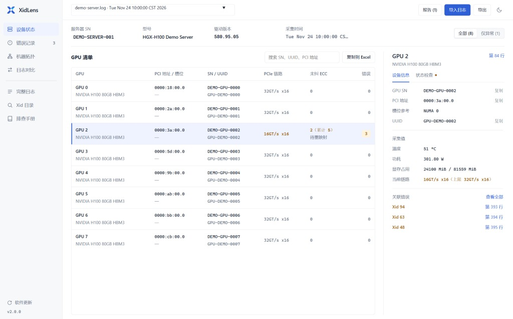
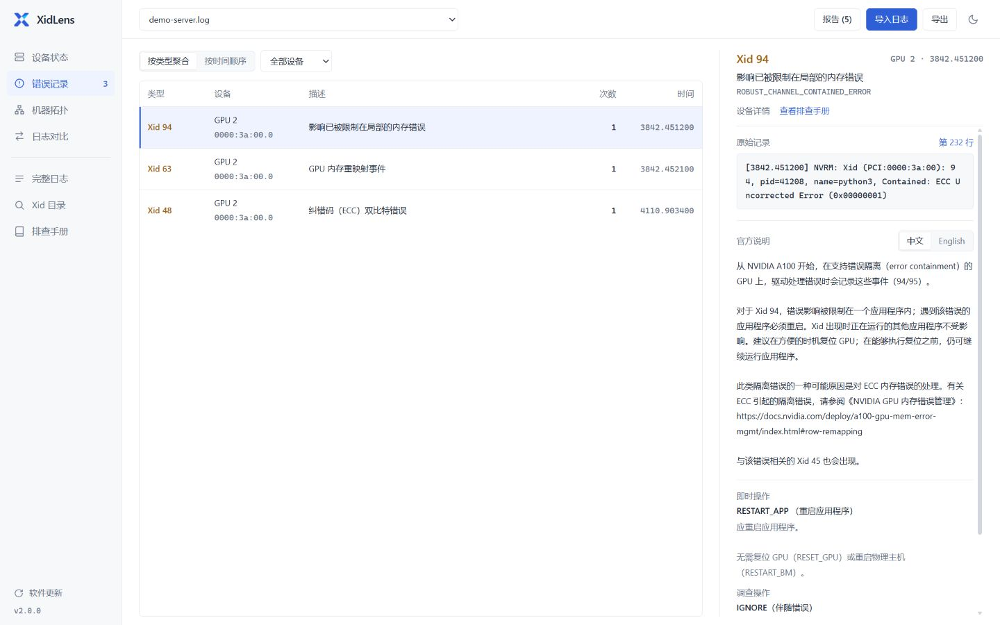
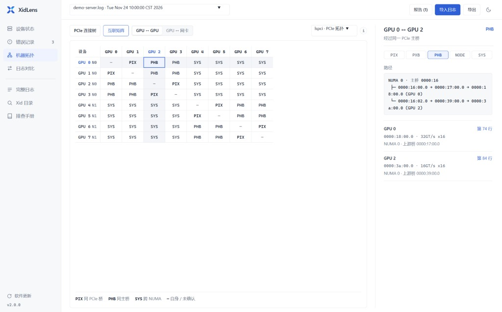
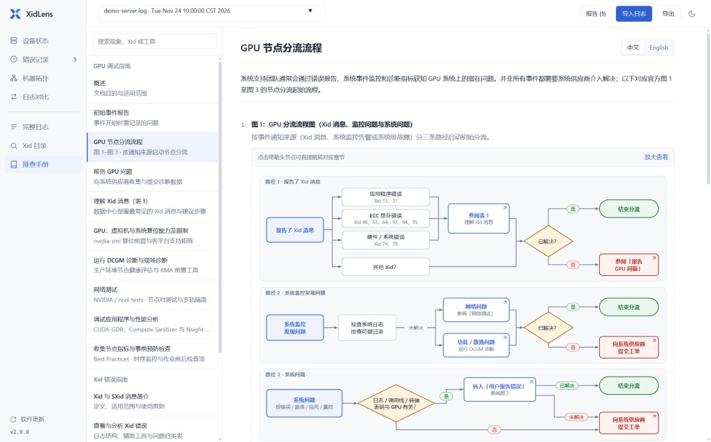

<h1 align="center">XidLens</h1>

  Local offline NVIDIA GPU log analyzer · Device Status · Error Records · PCIe Topology · Official Xid &amp; Triage Manual

  <a href="https://github.com/ohhellojie/xidlens/releases/latest">Download for Windows</a> ·
  <a href="docs/usage.md">Usage (Chinese)</a> ·
  <a href="CHANGELOG.md">Changelog</a> ·
  <a href="README.md">简体中文</a>

  
  
  

---

XidLens parses `nvidia-bug-report`, `dmesg`, `journalctl`, `nvidia-smi`, and `lspci` logs offline on your machine. It turns large raw diagnostic logs into clear views for device health, Xid / SXid / AER errors, PCIe topology, and side-by-side report comparison — with direct source-line navigation and built-in NVIDIA reference documentation.

*Device status overview using synthetic demonstration data. Click any screenshot to view at full resolution.*

## Quick Start

1. Download the latest portable Windows x64 ZIP from [Releases](https://github.com/ohhellojie/xidlens/releases/latest).
2. Extract it and run `XidLens.exe` (no installation required).
3. Click **导入日志** (Import logs) at the top to open log files or archives.

> **Requirements**: Windows 10 or Windows 11 (x64) with Microsoft Edge WebView2 Runtime. The UI is in Simplified Chinese. All log parsing stays 100% local and offline.

## Core Features

### 1. Device Status & Fault Filtering
- Extracts server SN, model, driver version, and GPU inventory (model, PCI bus ID, slot reference, SN, UUID, PCIe link speed/width, uncorrectable ECC, and row remapping status).
- Supports fast filtering by SN / UUID / PCI address, a faults-only toggle, right-hand health inspection, and one-click copy to Excel.

### 2. Error Records & Official Xid Catalog
- Browse Xid, NVSwitch SXid, driver initialization failures, and PCIe AER records grouped by type or chronologically, filtered by device.
- Displays the raw log snippet and source line alongside bilingual **NVIDIA Xid Catalog** explanations, immediate actions, and investigative actions, with one-click jumps to the manual or catalog.

### 3. Machine Topology & Derived PCIe Matrix
- Provides both a **PCIe tree** and a **connectivity matrix**, switching cleanly between `GPU ↔ GPU` and `GPU ↔ NIC`.
- In addition to parsing `nvidia-smi topo -m` / `-mp`, XidLens automatically derives a PCIe connectivity matrix (`PIX / PXB / PHB / NODE / SYS`) from `lspci -t` / `lspci -Dnnvv` bridges and NUMA nodes when `topo -m` is missing from `nvidia-bug-report.sh`, complete with shared upstream path diagrams.

### 4. Report Comparison & Source Drawer
- **Report Comparison**: Matches GPUs across two reports by unique SN or UUID, highlights changed fields, and opens both source snippets side by side.
- **Source Drawer & Full Log Reader**: Click any line number to inspect context in a slide-over drawer, or jump straight into the virtual-scrolling full log reader (`Ctrl+F` search, `Ctrl+G` jump to line, error markers).

### 5. Official Xid Catalog & Interactive Triage Manual
- Bundles the bilingual **NVIDIA Xid Catalog** (`Ctrl+K` quick search, Xid 144–150 decode table, Xid 154 associations) and the **NVIDIA GPU Debug Guidelines** troubleshooting manual.
- Includes bilingual, theme-aware interactive triage flowcharts (Figures 1–3) with zoom lightbox and clickable nodes that jump directly to referenced sections.

## Formats & Local Data

| Category | Details |
| --- | --- |
| **Inputs** | `nvidia-bug-report`, `dmesg`, `journalctl`, `nvidia-smi`, `lspci`, `dcgmi diag --json`, plus `.gz` / `.zip` / `.tar` / `.tgz` archives |
| **Exports** | Copy inventory to Excel or export `TSV`; troubleshooting summary as `TXT`; full structured report as `JSON` |
| **Storage** | Reports, cached log copies, rules, and settings live in the `runtime/` folder next to `XidLens.exe` (keep it when upgrading) |
| **Updates** | Check for app, NVIDIA parsing rules, Xid catalog, and manual updates individually in the bottom-left Software Updates dialog |

## Documentation

Documentation is written in Chinese:

| Guide | Topic |
| --- | --- |
| [Usage](docs/usage.md) | Views, workflows, and exports |
| [Status & Topology](docs/diagnostics.md) | Check definitions, `lspci` topology derivation, and collection commands |
| [Structured Events](docs/structured-events.md) | DCGM JSON, NVSwitch SXid, and experimental GOE parsing |
| [Reference Updates](docs/reference-packages.md) | Reference JSON schema and independent release format |
| [Offline & Online Rules](docs/catalog.md) | Syncing NVIDIA rules and building custom offline rule packages |
| [Run from Source & Build](docs/development.md) | Running locally, running tests, Windows packaging, and privacy checks |
| [Contributing](CONTRIBUTING.md) | Reporting issues, redacting logs, and contribution guidelines |

Report parsing issues in [Issues](https://github.com/ohhellojie/xidlens/issues/new?template=bug_report.yml) with a minimal redacted log sample. See [CHANGELOG.md](CHANGELOG.md) for version history.

## License & Notice

Source code is licensed under [MIT](LICENSE). Chinese reference content is an unofficial translation of NVIDIA's public documentation with official source links preserved; see [NOTICE.md](NOTICE.md) for third-party rights.
