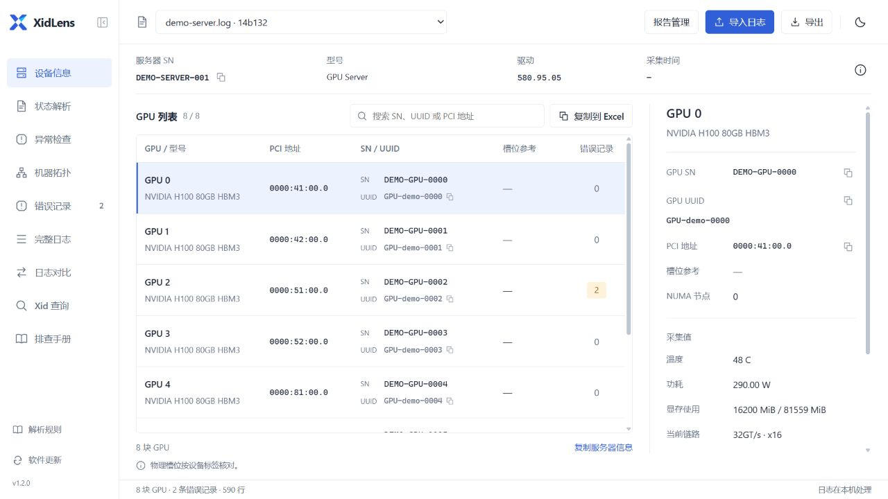
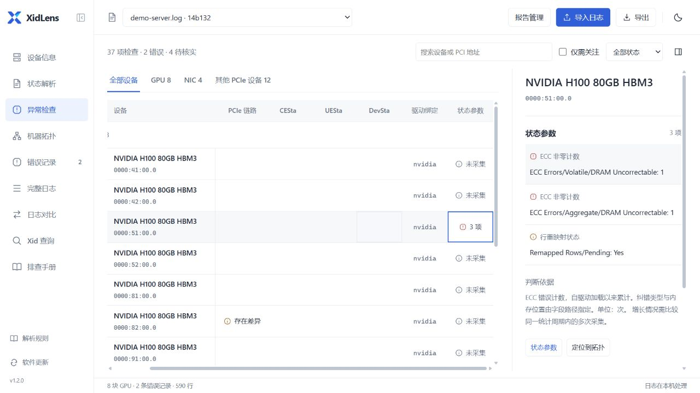
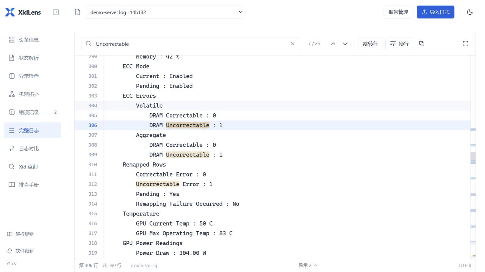
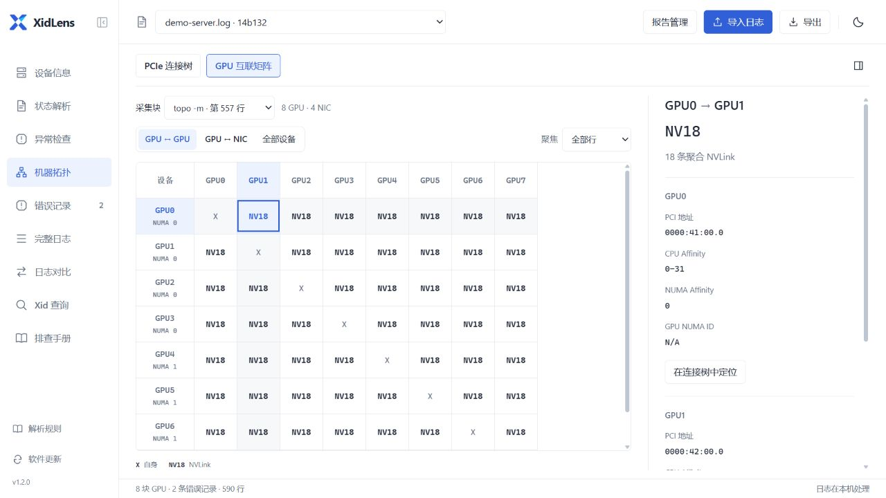

<h1 align="center">XidLens</h1>

  <a href="https://github.com/ohhellojie/xidlens/releases/latest">Download for Windows</a> ·
  <a href="docs/usage.md">Usage (Chinese)</a> ·
  <a href="README.md">简体中文</a>

XidLens processes NVIDIA GPU logs locally, organizes device information, errors, and diagnostic checks, and links findings to their source lines. It supports analysis across multiple logs, event timelines, report comparison, and sharing redacted excerpts.

*Device information page. Screenshots use sample data; click to view at full resolution.*

## Download

1. Download the Windows x64 ZIP from [Releases](https://github.com/ohhellojie/xidlens/releases/latest).
2. Extract it and open `XidLens.exe`.
3. Click 导入日志 (Import logs) and select files, or open the built-in sample first.

Requires Windows 10 or Windows 11 and Microsoft Edge WebView2 Runtime. The interface is in Chinese.

## Diagnostics and source logs

Supports text output from `nvidia-bug-report`, `dmesg`, `journalctl`, `nvidia-smi`, and `lspci`, as well as GZ, ZIP, and TAR archives.

- **Diagnostic overview**: filter findings and inspect their basis, evidence, and next steps. Checks with no detected anomaly, missing data, and conflicting values are shown separately.
- **Devices and status**: extract server and GPU identities, inspect `nvidia-smi -q` snapshots, and check PCIe links, ECC, row remapping, and other status fields.
- **Event timeline**: filter errors, driver loads, explicit reset results, and snapshots by device, type, and time, preserving source and boot segments.

Open source lines directly from analysis results. The full log reader supports text search, line navigation, and focus mode, and preserves reading position when changing pages or reports.

## Multiple logs and comparison

Select files from the same collection in report management to create a joint analysis of devices, events, checks, and timelines. Each source link opens the original line in the corresponding report.

Select two reports to compare device properties, errors, and counters. GPUs are matched by unique, consistent serial numbers or UUIDs. Counter changes require comparable measurements; missing values, conflicts, and reasons a comparison is unavailable remain visible. Inspect both source logs side by side. See [usage](docs/usage.md) for steps and comparison conditions.

## Evidence and sharing

Select a line range in the log and save a bookmark with notes and tags. Choose bookmarks to create a redacted preview, review or edit the excerpts, source names, and notes, then confirm export as TXT or JSON.

Evidence assistance extracts selected excerpts locally by default, without AI. Optionally choose a local model or a compatible HTTPS API, review the redacted excerpts, additional notes, endpoint, and model, then explicitly confirm sending. Only the content selected for that request is sent. Returned observations, items to verify, and summaries include references; summaries can be edited and copied. See [evidence assistance](docs/evidence-assistant.md) for configuration and data handling details.

## DCGM and event formats

Import DCGM JSON and filter results by outcome, entity, or test name, with a run filter for repeated diagnostics. Pass, fail, warning, skipped, not run, and unknown results remain distinct, with runtime errors listed separately. Details retain source lines and JSON Pointers.

NVSwitch SXid and GPU Xid use separate device identities. GOE parsing is experimental and preserves the full event type, scope, and source evidence. See [structured diagnostic results and events](docs/structured-events.md) for supported formats and version conditions.

## Topology visualization

Converts `lspci` and `nvidia-smi topo` output into a PCIe tree and connectivity matrix for GPUs, network adapters, and other devices. Supports device filtering, path navigation, and affinity details.

Devices with an unconfirmed upstream connection are listed separately. See [status and topology](docs/diagnostics.md) for field descriptions, collection commands, and slot verification.

## Documentation and updates

Device inventories can be copied to Excel or exported as TSV, log summaries as TXT, and full records as JSON. Keep the `runtime` folder when upgrading; it stores reports, log copies, bookmarks, and settings.

The built-in Xid reference and troubleshooting manual can be updated independently. The app checks online for new versions by default; this can be disabled in settings. Downloads and installation require confirmation.

Documentation is in Chinese:

- [Usage](docs/usage.md) · [Log collection and interpretation](docs/diagnostics.md)
- [Structured results](docs/structured-events.md) · [Evidence assistance](docs/evidence-assistant.md)
- [Reference updates](docs/reference-packages.md) · [Parsing rules](docs/catalog.md)
- [Run from source and build](docs/development.md) · [Contributing](CONTRIBUTING.md)

Report parsing issues in [Issues](https://github.com/ohhellojie/xidlens/issues/new?template=bug_report.yml) with a minimal redacted log sample. See [Releases](https://github.com/ohhellojie/xidlens/releases) for version changes.

Code is licensed under [MIT](LICENSE). Chinese reference content is an unofficial translation with links to official sources. See [NOTICE](NOTICE.md) for third-party rights.
