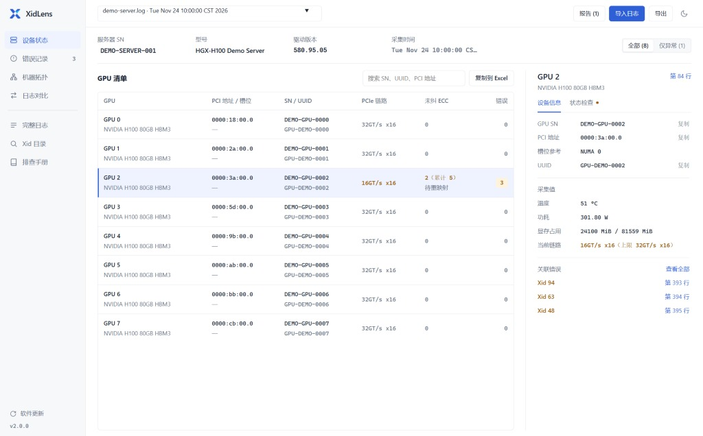
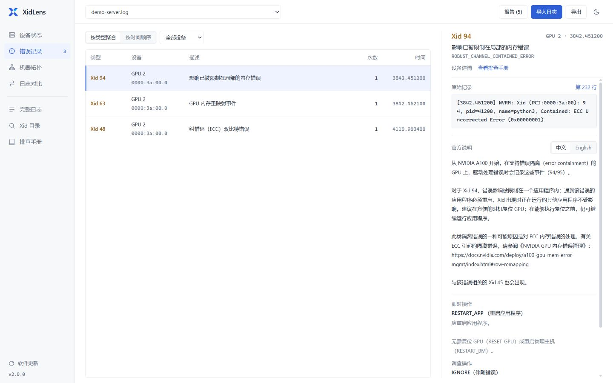
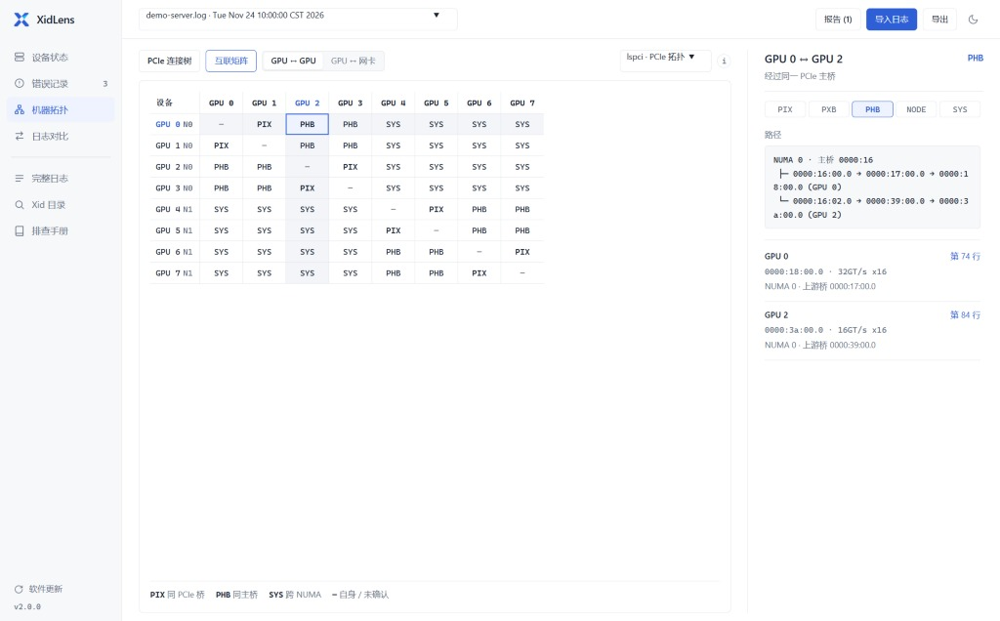
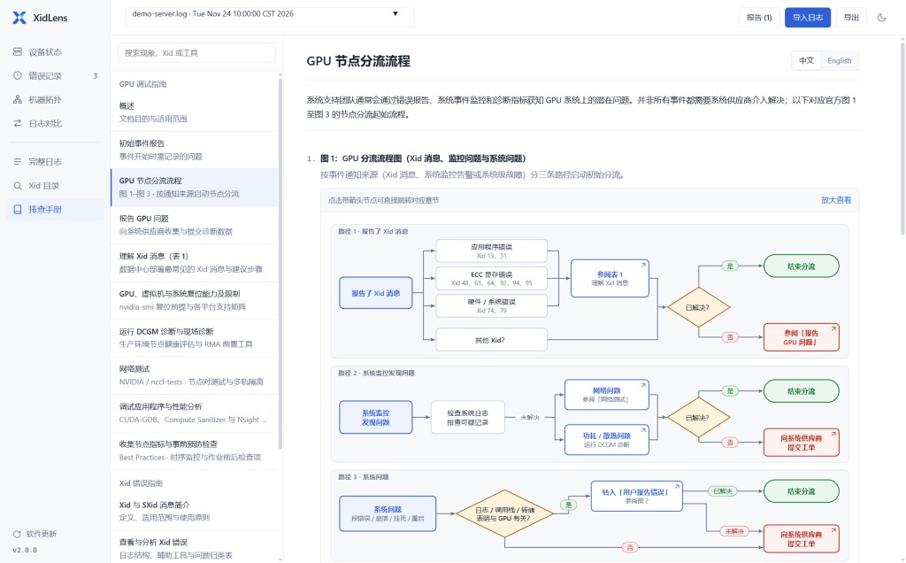

<h1 align="center">XidLens</h1>

  本机离线解析 NVIDIA GPU 日志的桌面排查工具 · 设备状态 · 错误记录 · PCIe 拓扑 · 官方 Xid 与分流手册

  <a href="https://github.com/ohhellojie/xidlens/releases/latest">下载 Windows 版</a> ·
  <a href="docs/usage.md">使用说明</a> ·
  <a href="CHANGELOG.md">更新记录</a> ·
  <a href="README.en.md">English</a>

  
  
  

---

XidLens 在本机离线解析 `nvidia-bug-report`、`dmesg`、`journalctl`、`nvidia-smi` 和 `lspci` 等日志，把分散在数十万行原始文本中的服务器与 GPU 状态、Xid / SXid / AER 错误、PCIe 互联拓扑以及两份报告的前后差异整理为清晰视图，并与原文行号及 NVIDIA 官方资料一一对应。

*设备状态主视图（使用合成演示数据，点击图片查看原图）。*

## 快速开始

1. 从 [Releases](https://github.com/ohhellojie/xidlens/releases/latest) 下载最新的 Windows x64 便携 ZIP 包。
2. 解压后双击 `XidLens.exe` 启动（免安装）。
3. 点击顶部「导入日志」，选择日志文件或压缩包即可开始分析。

> **运行环境**：Windows 10 / Windows 11 x64，需已安装 Microsoft Edge WebView2 Runtime（Windows 11 默认自带）。界面为简体中文，日志全程仅在本机解析，不上传任何日志数据。

## 核心功能

### 1. 设备状态与异常筛选
- 自动提取服务器 SN、机型、驱动版本与 GPU 清单（型号、PCI 地址、槽位参考、SN、UUID、PCIe 链路速率与位宽、未纠 ECC 与行重映射状态）。
- 支持按 SN / UUID / PCI 地址快速检索、一键筛选「仅异常」、查看右侧设备详情与状态检查，并支持一键「复制到 Excel」。

### 2. 错误记录与官方 Xid 对照
- 支持「按类型聚合」与「按时间顺序」浏览 Xid、NVSwitch SXid、驱动初始化失败与 PCIe AER 记录，并按设备筛选。
- 右侧保留原始日志片段与行号定位，严格对照 **NVIDIA 官方 Xid Catalog** 展示中英双语说明、即时操作（Immediate Action）与调查操作（Investigative Action），可直达排查手册或 Xid 目录。

### 3. 机器拓扑与自动推导互联矩阵
- 同时提供 **PCIe 连接树** 与 **互联矩阵**，支持 `GPU ↔ GPU` 及 `GPU ↔ 网卡` 视角切换。
- 除解析 `nvidia-smi topo -m` / `-mp` 外，当 `nvidia-bug-report.sh` 缺少 `topo -m` 时，自动基于 `lspci -t` / `lspci -Dnnvv` 桥结构与 NUMA 节点推导 PCIe 互联矩阵（`PIX / PXB / PHB / NODE / SYS`），并在右侧可视化公共上游路径与两端链路信息。

### 4. 日志对比与原文抽屉
- **日志对比**：在两份报告间按唯一 SN 或 UUID 自动匹配 GPU，聚焦变化字段并支持并排核对两侧原文行号与片段。
- **原文抽屉与完整日志**：点击分析结果中的任意行号，即可在右侧滑出原文抽屉就地核对，并一键切入支持虚拟滚动、`Ctrl+F` 搜索、`Ctrl+G` 行号跳转和异常定位的完整日志阅读器。

### 5. 官方 Xid 目录与交互式排查手册
- 内置 **NVIDIA Xid Catalog**（支持 `Ctrl+K` 速查、中英文切换、Xid 144–150 解码表及关联 Xid 154）与 **GPU Debug Guidelines** 排查手册。
- 「GPU 节点分流流程」内置中英双语、深浅主题自适应的官方分流流程图（图 1～图 3），支持放大查看与点击节点直达对应排查章节。

## 支持格式与数据目录

| 类别 | 说明 |
| --- | --- |
| **输入格式** | `nvidia-bug-report`、`dmesg`、`journalctl`、`nvidia-smi`、`lspci`、`dcgmi diag --json` 等文本及 `.gz` / `.zip` / `.tar` / `.tgz` 压缩包 |
| **导出格式** | 设备清单复制到 Excel 或导出 `TSV`；排障摘要导出 `TXT`；完整解析结果导出 `JSON` |
| **本机存储** | 报告、日志副本、规则与设置保存在程序同目录 `runtime/` 文件夹中；覆盖升级 EXE 时请保留该目录 |
| **在线更新** | 左下角「软件更新」可统一检查软件本体、NVIDIA Xid 解析规则、Xid 目录与排查手册更新；自动检查可关闭，下载与安装均需确认 |

## 文档导航

| 文档 | 内容 |
| --- | --- |
| [使用说明](docs/usage.md) | 界面操作、视图说明与导出步骤 |
| [状态、异常检查与机器拓扑](docs/diagnostics.md) | 状态判定范围、`lspci` 拓扑推导原理与采集命令 |
| [结构化诊断结果与事件](docs/structured-events.md) | DCGM JSON、NVSwitch SXid 与实验性 GOE 解析说明 |
| [资料更新](docs/reference-packages.md) | Xid 目录与排查手册 JSON 资料包格式及独立发布方式 |
| [离线与在线 Xid 规则](docs/catalog.md) | 在线规则同步与离线 XLSX/JSON 规则生成方式 |
| [源码运行与构建](docs/development.md) | 从源码启动、测试套件、Windows 打包与隐私校验 |
| [贡献说明](CONTRIBUTING.md) | 反馈问题规范、日志脱敏要求与提交指南 |

反馈解析问题或建议请提交 [Issue](https://github.com/ohhellojie/xidlens/issues/new?template=bug_report.yml)，并附上已脱敏的最小复现日志片段。完整版本演变见 [CHANGELOG.md](CHANGELOG.md)。

## 许可证与声明

本项目源代码采用 [MIT](LICENSE) 许可证开源。内置中文 Xid 目录与排查手册为基于 NVIDIA 官方公开文档整理的非官方译文，均保留官方来源链接；第三方组件及资料权利详见 [NOTICE.md](NOTICE.md)。
