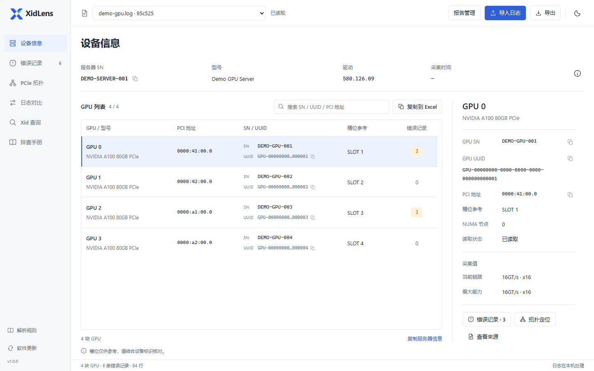
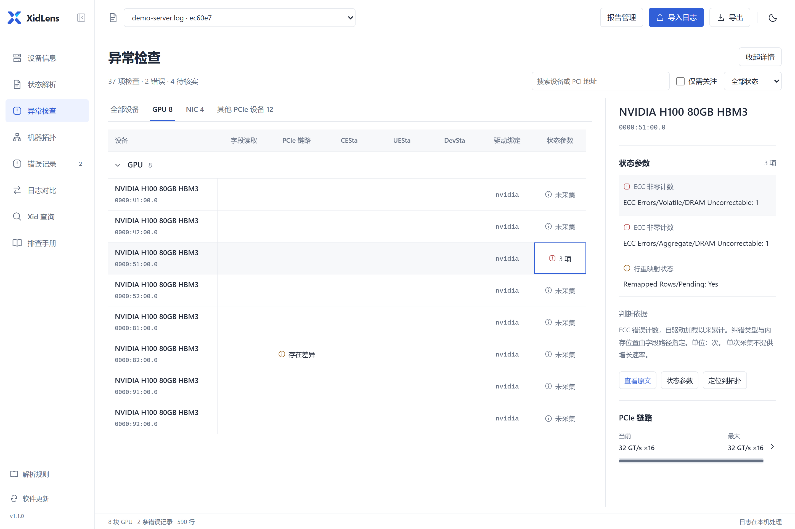
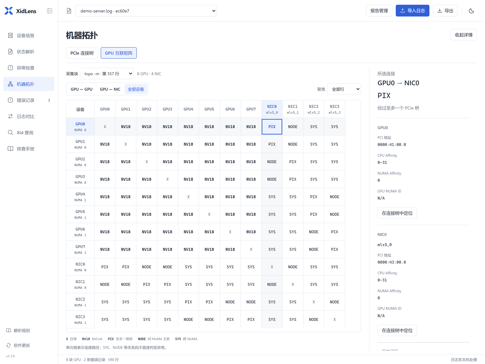

<h1 align="center">XidLens</h1>

  <a href="https://github.com/ohhellojie/xidlens/releases/latest">下载 Windows 版</a> ·
  <a href="docs/usage.md">使用说明</a> ·
  <a href="README.en.md">English</a>

XidLens 是一款离线的 NVIDIA GPU 日志分析工具，支持设备信息提取、Xid 错误分析、状态检查和拓扑可视化。日志在本机解析。

*设备信息页。截图使用演示数据，点击查看原图。*

## 下载

1. 从 [Releases](https://github.com/ohhellojie/xidlens/releases/latest) 下载 Windows x64 ZIP 包。
2. 解压，双击 `XidLens.exe`。
3. 点击导入日志，选择日志文件。

支持 Windows 10 和 Windows 11，需安装 Microsoft Edge WebView2 Runtime。界面为中文。

## 日志分析

支持 `nvidia-bug-report`、`dmesg`、`journalctl`、`nvidia-smi` 和 `lspci` 的文本输出，以及 GZ、ZIP 和 TAR 压缩包。

- **设备信息**：提取服务器信息和 GPU 清单，包括型号、序列号、UUID 和 PCI 地址。
- **完整日志**：搜索原文、跳转行号、定位异常，支持专注阅读和阅读位置记忆。
- **错误记录**：按设备归类 Xid、初始化失败和 PCIe 错误，保留原文和行号。
- **状态解析**：解析 `nvidia-smi -q` 参数，提供字段说明，支持切换不同采集结果。
- **异常检查**：检查 PCIe 链路、ECC 和行重映射等状态，标记错误、待核实项和缺失数据。

检查结果附有判断依据和日志原文，数据不足的项目会单独标记。字段含义与采集方法见[状态与拓扑](docs/diagnostics.md)。

## 拓扑可视化

将 `lspci` 和 `nvidia-smi topo` 输出转换为 PCIe 连接树和互联矩阵，展示 GPU、网卡等设备的连接关系。支持设备筛选、路径定位和亲和性查询。

连接树将上游未确认的设备集中列出。物理槽位按设备标签核对。

## 对比与导出

按唯一的序列号或 UUID 匹配 GPU，对比设备参数和错误记录，并列出未匹配的设备。两份日志的原文可并排查看。

设备清单可复制到 Excel 或导出为 TSV，日志摘要导出为 TXT，完整记录导出为 JSON。

## 文档

内置 Xid 说明和排查手册，可独立更新。软件支持后台检查新版本，更新由用户确认。报告、日志副本和设置保存在 `runtime` 文件夹，升级时需保留。

- [使用说明](docs/usage.md) · [日志采集与判断范围](docs/diagnostics.md)
- [资料更新](docs/reference-packages.md) · [解析规则](docs/catalog.md)
- [源码运行与构建](docs/development.md) · [贡献说明](CONTRIBUTING.md)

解析问题请提交至 [Issues](https://github.com/ohhellojie/xidlens/issues/new?template=bug_report.yml)，附上可复现问题的脱敏日志片段。版本变化见 [Releases](https://github.com/ohhellojie/xidlens/releases)。

代码采用 [MIT](LICENSE) 许可证。中文资料为非官方译文，保留官方来源；第三方资料权利见 [NOTICE](NOTICE.md)。
