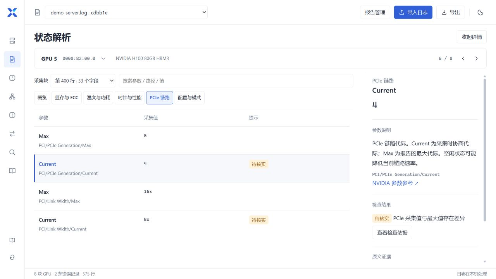

<h1 align="center">XidLens</h1>

离线分析 NVIDIA GPU 日志，查看状态、异常与机器拓扑。

  <a href="https://github.com/ohhellojie/xidlens/releases/latest">下载 Windows 版</a> ·
  <a href="docs/usage.md">使用说明</a> ·
  <a href="https://github.com/ohhellojie/xidlens/releases">更新记录</a> ·
  <a href="README.en.md">English</a>

*实际界面，使用演示数据。*

## 开始使用

1. 在 [Releases](https://github.com/ohhellojie/xidlens/releases/latest) 下载 Windows x64 ZIP 包。
2. 解压，双击 `XidLens.exe`。
3. 点击“导入日志”，选择一份或多份文件。

运行环境：Windows 10 / 11 x64、Microsoft Edge WebView2 Runtime。界面使用中文。

支持 nvidia-bug-report、dmesg / journal、nvidia-smi、lspci 文本，以及 GZ、ZIP、TAR 压缩包。日志在本机解析。

## 功能

| 功能 | 内容 |
| --- | --- |
| 设备信息 | 查看服务器 SN、GPU SN / UUID、PCI 地址、采集值和字段来源；搜索并复制到 Excel。 |
| 错误记录 | 聚合 Xid、初始化失败、PCIe/AER 记录，查看原文、行号和规则说明。 |
| 状态解析 | 按 GPU、采集块和参数分组查看 nvidia-smi -q 字段、说明与原文。 |
| 异常检查 | 查看 PCIe、ECC、行重映射等检查结果，区分错误、待核实和数据不足。 |
| 机器拓扑 | 查看 PCIe 连接树、GPU / NIC 互联矩阵和亲和性，支持筛选与设备定位。 |
| 日志对比 | 按唯一 SN / UUID 匹配 GPU，比较设备字段和错误记录，并排查看两份原文。 |
| 报告管理 | 搜索、筛选、多选重新解析和删除；导出 TSV、TXT、JSON。 |
| Xid 资料 | 搜索中英文 Xid 说明，浏览排查手册，查看来源并独立更新资料。 |

查看异常检查与拓扑矩阵

### 异常检查

### GPU / NIC 拓扑

字段以日志记录为准。缺失或冲突字段保留原状；槽位仅供参考。错误说明与建议来自匹配规则，需结合原文和设备状态判断。

## 更新与数据

软件默认每天在后台检查更新，发现新版后提示；下载和安装由用户选择。也可退出程序后替换 EXE，保留同目录的 `runtime` 文件夹。

报告、原日志副本和设置保存在 `runtime`。中文 Xid 资料和排查手册可分别更新；[解析规则](docs/catalog.md)支持导入 XLSX / JSON。操作细节见[使用说明](docs/usage.md)、[状态与拓扑](docs/diagnostics.md)和[资料更新](docs/reference-packages.md)。

## 开发与反馈

[源码运行与构建](docs/development.md) · [贡献说明](CONTRIBUTING.md) · [问题反馈](https://github.com/ohhellojie/xidlens/issues/new?template=bug_report.yml)

反馈解析问题时，请提供可复现的脱敏日志片段。

代码采用 [MIT](LICENSE) 许可证。中文资料为非官方译文，保留官方来源；第三方资料权利见 [NOTICE](NOTICE.md)。
